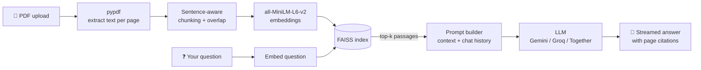

<div align="center">

# 📄 PDF Q&A Bot

### Chat with your PDFs. Get answers with page-level citations.

A lightweight **Retrieval-Augmented Generation (RAG)** app that runs in Google Colab.
Upload one or more PDFs, ask questions in plain English, and get streamed answers grounded in your documents.


[Features](#-features) · [How it works](#-how-it-works) · [Quick start](#-quick-start) · [Configuration](#%EF%B8%8F-configuration) · [Troubleshooting](#-troubleshooting) · [Roadmap](#-roadmap)

</div>

---

## ✨ Features

| | Feature | Description |
|---|---|---|
| 📚 | **Multi-PDF support** | Upload several PDFs and search all of them, or restrict a question to one file. |
| 📌 | **Page citations** | Every answer cites the file and page it came from, e.g. `report.pdf p.4`. |
| 🔍 | **Source viewer** | Optionally shows the retrieved passages with similarity scores so you can verify the answer. |
| 💬 | **Conversational memory** | Follow-up questions like *"and why?"* work, because recent turns are kept in context. |
| ⚡ | **Streaming responses** | Answers appear token by token instead of after a long wait. |
| 📝 | **One-click summary** | Generates an overview, key points, and conclusions. |
| 💡 | **Suggested questions** | Proposes useful questions to ask about your document. |
| 📥 | **Export chat** | Download the full conversation as a Markdown file. |
| 🎛️ | **Tunable settings** | Change model, temperature, number of retrieved passages, chunk size, and overlap from the UI. |
| 🔌 | **Swappable LLM provider** | Works with Google Gemini, Groq, or Together.ai through one OpenAI-compatible client. |
| 🛡️ | **Friendly errors** | Detects password-protected and scanned (image-only) PDFs and explains what went wrong. |

---

## 🧠 How it works



1. **Extract**: text is pulled from each page, so page numbers are preserved.
2. **Chunk**: text is split on sentence boundaries into overlapping chunks.
3. **Embed & index**: each chunk is embedded locally with `all-MiniLM-L6-v2` and stored in a FAISS index (cosine similarity).
4. **Retrieve**: your question is embedded and the most similar chunks are fetched.
5. **Generate**: the chunks, recent chat history, and your question go to the LLM, which is instructed to answer **only** from the provided context and to say so when the answer isn't there.

> No LangChain is used, so the project doesn't break when LangChain reorganizes its packages.

---

## 🛠️ Tech stack

- **UI:** [Gradio](https://www.gradio.app/)
- **PDF parsing:** [pypdf](https://pypdf.readthedocs.io/)
- **Embeddings:** [sentence-transformers](https://www.sbert.net/) (`all-MiniLM-L6-v2`, runs locally)
- **Vector search:** [FAISS](https://github.com/facebookresearch/faiss)
- **LLM access:** [OpenAI Python SDK](https://github.com/openai/openai-python) pointed at an OpenAI-compatible endpoint
- **LLM providers:** Google Gemini (default), Groq, Together.ai

---

## 🚀 Quick start

### Option A: Google Colab (recommended)

1. Open a new notebook at [colab.research.google.com](https://colab.research.google.com/).
2. **Cell 1:** install dependencies

   ```python
   !pip -q install gradio openai faiss-cpu pypdf sentence-transformers numpy
   ```

3. **Cell 2:** paste the full contents of [`pdf_qa_bot.py`](pdf_qa_bot.py) and run it.
4. When prompted, paste your API key (input is hidden).
5. Open the public Gradio link, upload a PDF, click **Process PDFs**, and start asking questions.

### Option B: Run locally

```bash
git clone https://github.com/<your-username>/pdf-qa-bot.git
cd pdf-qa-bot

python -m venv .venv
source .venv/bin/activate        # Windows: .venv\Scripts\activate

pip install -r requirements.txt

export GEMINI_API_KEY="your-key-here"   # Windows (PowerShell): $env:GEMINI_API_KEY="your-key-here"
python pdf_qa_bot.py
```

The app prints a local URL (and a public share link, if enabled).

---

## 🔑 Getting an API key

| Provider | Cost | Where to get a key | `PROVIDER` value |
|---|---|---|---|
| **Google Gemini** (default) | Free tier available | [aistudio.google.com](https://aistudio.google.com/) → *Get API key* | `"gemini"` |
| **Groq** | Free tier available | [console.groq.com](https://console.groq.com/) → *API Keys* | `"groq"` |
| **Together.ai** | Requires a deposit | [together.ai](https://www.together.ai/) → *Settings → API Keys* | `"together"` |

Free-tier limits and available models change over time, so check each provider's current docs.

---

## ⚙️ Configuration

Set the provider at the top of `pdf_qa_bot.py`:

```python
PROVIDER = "gemini"   # "gemini", "groq", or "together"
```

The key is read from, in order:

1. A **Colab Secret** named `GEMINI_API_KEY` / `GROQ_API_KEY` / `TOGETHER_API_KEY`
2. An **environment variable** with the same name
3. A **hidden prompt** at runtime

**In-app settings**

| Setting | What it does |
|---|---|
| Model | Pick from the list or type any model name your provider supports. |
| Temperature | Lower is more factual, higher is more creative. |
| Passages to retrieve (k) | How many chunks are sent to the LLM as context. |
| Chunk size / overlap | Controls how documents are split. Reprocess your PDFs after changing these. |
| Show source passages | Toggle the citation panel under each answer. |

---

## 🧯 Troubleshooting

| Problem | Fix |
|---|---|
| `Chatbot.__init__() got an unexpected keyword argument 'type'` | You're on Gradio 6. Use the latest `pdf_qa_bot.py`, which supports both Gradio 5 and 6. |
| `API key not valid` / `401` / `403` | The key was copied incorrectly or revoked. Create a new one and paste it again. |
| `model not found` | Providers rename models. Type a current model name into the **Model** box. |
| `429` / quota errors | You hit the free-tier rate limit. Wait a minute and retry. |
| "No extractable text" | The PDF is scanned (images only). It needs OCR, which isn't included yet. |
| `HF_TOKEN` warning | Harmless. It only means the embedding model downloaded without a Hugging Face login. |

---

## 🔒 Security notes

- **Never hardcode API keys** in code or commit them to GitHub. Use Colab Secrets, environment variables, or the runtime prompt.
- If a key is ever pasted into a public place, **revoke it and create a new one**.
- `share=True` creates a **public link**. Anyone with it can use the app, share the loaded documents, and spend your API quota. Don't post the link publicly, or set `share=False`.
- Your PDF text is sent to the chosen LLM provider to generate answers. Don't upload documents you aren't allowed to share with that provider.

---

## 🗺️ Roadmap

- [ ] OCR support for scanned PDFs
- [ ] Persistent index (save and reload FAISS across sessions)
- [ ] Hybrid search (BM25 + embeddings) and re-ranking
- [ ] Support for DOCX, TXT, and web page sources
- [ ] Password-protected public sharing
- [ ] Optional local LLM mode (no API key needed)

---

## 📁 Project structure

```
pdf-qa-bot/
├── pdf_qa_bot.py       # Complete app: ingestion, retrieval, LLM calls, UI
├── requirements.txt    # Python dependencies
└── README.md
```

---

## 🤝 Contributing

Issues and pull requests are welcome. For larger changes, please open an issue first to discuss what you'd like to change.

---

## 📜 License

Released under the [MIT License](LICENSE). Add a `LICENSE` file to your repository if you choose this license.

---

<div align="center">

Built with Python, FAISS, and Gradio. If this helped you, consider giving the repo a ⭐

</div>
